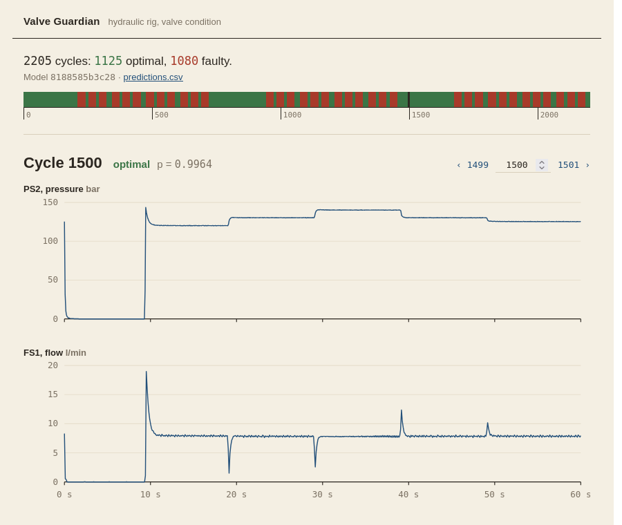
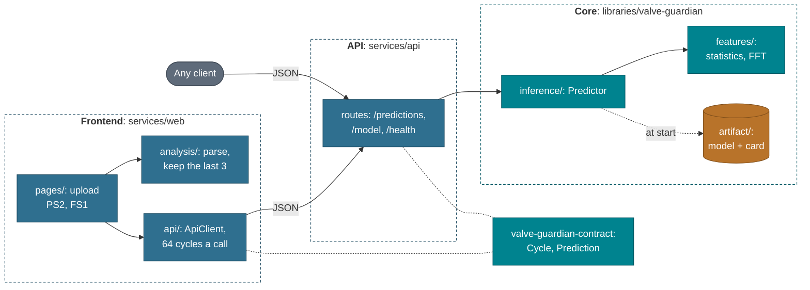
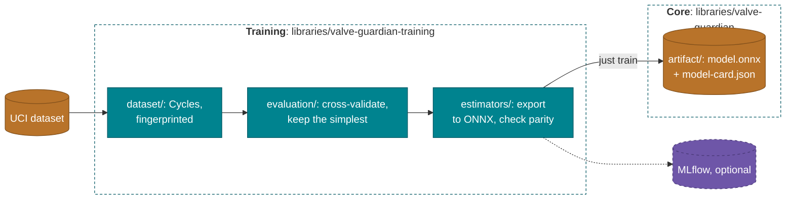
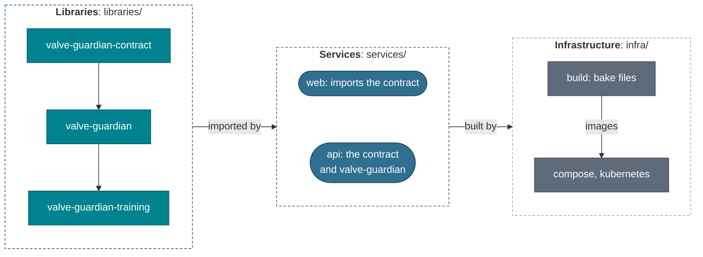

# Predictive Valve Guardian

[](LICENSE)
[](https://www.python.org/)
[](https://docs.astral.sh/uv/)
[](https://fastapi.tiangolo.com/)
[](https://onnx.ai/)
[](https://mlflow.org/)
[](https://just.systems/man/en/)
[](.agents/kanon.md)

Predict, cycle by cycle, whether the valve of a hydraulic system is in optimal
condition, from its pressure and flow sensors.

> [!NOTE]
> The original 2025 project was written for an assignment.<br>
> I don't keep obsolete projects in my portfolio, so after
> [1.3.0](https://github.com/Ophiase/predictive-valve-guardian/tree/v1.3.0) I
> quickly rebuilt it without the legacy choices of the pre-agentic era.

<div align="center">
  
</div>

## Summary

- [What is in it](#what-is-in-it)
- [Architecture](#architecture)
- [Quickstart](#quickstart)
- [Training](#training)
- [Problem statement](#problem-statement)
- [Results](#results)
- [Layout](#layout)
- [Contributors](#contributors)

## What is in it

- **Typed API, decoupled page**: FastAPI, OpenAPI at `/docs`; the page is
  only an HTTP client.
- **One contract**: pydantic models shared by the API, the page and the
  training.
- **Model selection**: repeated stratified cross-validation, simplest model
  within one deviation, chronological holdout.
- **ONNX serving**: exported with a parity check; no scikit-learn in the API
  image.
- **Model card**: metrics, dataset hash and versions travel with the model.
- **Optional MLflow**: tracking and registry when `MLFLOW_TRACKING_URI` is
  set.
- **Bake builds**: one `Containerfile` per service; non-root, read-only
  images.
- **CI as recipes**: `just ci`, the same on a laptop and in any pipeline
  ([why](infra/README.md)).
- **Kubernetes**: bjw-s app-template values, one concern per file, held to
  the compose file by a parity check.
- **Strict infrastructure**: yamllint, compose smells, kubeconform,
  kube-linter and hadolint on every commit.

## Architecture

Serving: two services, one HTTP boundary.



A solid arrow runs on every request, a dotted one once at start; a dotted
line without a head imports the contract. The page never imports the model.

Training: offline, and the only place scikit-learn, XGBoost and MLflow live.



## Quickstart

[uv](https://docs.astral.sh/uv/getting-started/installation/) and
[just](https://just.systems/man/en/) are the prerequisites; Docker with buildx
for the images.

```sh
just run                # the API on localhost:8000, the page on localhost:8080
just stop
```

From any pipeline:

```sh
infra/pipeline/bootstrap.sh
just ci ghcr.io/me      # every check, then the images at the commit's tag
```

Without Docker:

```sh
just install
just serve              # the same two ports
```

The API on its own:

```sh
curl -s localhost:8000/model | jq '{identifier, estimator, holdout}'
curl -s localhost:8000/predictions -H 'content-type: application/json' \
  -d "{\"cycles\": [{\"pressure\": $(jq -nc '[range(6000)] | map(150)'), \"flow\": $(jq -nc '[range(600)] | map(8)')}]}"
```

## Training

```sh
just data               # the UCI dataset, into data/hydraulic
just benchmark          # every model on every representation, into docs/benchmark.md
just train              # select, fit, export; tracked in runs/
```

With MLflow:

```sh
just mlflow                                         # a local server on localhost:5000
MLFLOW_TRACKING_URI=http://127.0.0.1:5000 just train
```

## Problem statement

The data comes from the UCI
[Condition monitoring of hydraulic systems](https://archive.ics.uci.edu/dataset/447/condition+monitoring+of+hydraulic+systems)
dataset.

A cycle is one complete operation of the system. There are $C = 2205$
cycles, and each cycle $i < C$ holds:

- $PS2_i$: pressure sensor 2, in bar, at 100 Hz: 6 000 values.
- $FS1_i$: flow sensor 1, in litres per minute, at 10 Hz: 600 values.
- $Profile_i$: cooler, valve, pump, accumulator and stable flag, where the
  valve condition $z_i \in \{73, 80, 90, 100\}$.

We learn whether $z_i = 100$:

$$f_\theta : \mathbb{R}^{6000} \times \mathbb{R}^{600} \to [0, 1]$$

## Results

The candidates are a logistic regression, a random forest and XGBoost, on the
raw signals or on per-cycle statistics (mean, deviation, extrema, deciles,
energy) of each signal and its first two differences, with or without the
magnitudes of the first 20 Fourier coefficients. The full table is in
[docs/benchmark.md](docs/benchmark.md); the head of it:

| Representation | Columns | Model | F1 | Brier |
| --- | --- | --- | --- | --- |
| statistics + 20 Fourier | 54 | logistic regression | 1.0000 ± 0.0000 | 0.0004 ± 0.0001 |
| raw | 6600 | random forest | 1.0000 ± 0.0000 | 0.0008 ± 0.0002 |
| statistics to slope + 20 Fourier | 68 | logistic regression | 0.9996 ± 0.0009 | 0.0004 ± 0.0005 |
| statistics only | 14 | logistic regression | 0.9124 ± 0.0104 | 0.0905 ± 0.0051 |

Repeated 5-fold stratified cross-validation, three repeats. The deployed model
is the first row: the simplest that reaches the best score. It scores 1.0 on
the chronological holdout too, the last 205 cycles after training on the
first 2 000.

The two evaluations disagree in one place, and it is the instructive one.
Without the Fourier magnitudes, the statistics of the first and second
differences reach an F1 of 0.99 in cross-validation, but 0.91 to 0.95 on the
chronological holdout, whatever the model: the last cycles drift away from
the first ones, and shuffled folds hide it. With the Fourier magnitudes, every
model scores 1.0 under both, which is why they are deployed.

## Layout



The page imports only the contract; the API, the contract and
`valve-guardian`; the training, all three libraries.

- [libraries/valve-guardian-contract](libraries/valve-guardian-contract/README.md):
  the pydantic models every side shares.
- [libraries/valve-guardian](libraries/valve-guardian/README.md): features,
  ONNX inference and the deployed model.
- [libraries/valve-guardian-training](libraries/valve-guardian-training/README.md):
  evaluation, selection, export and tracking.
- [services/api](services/api/README.md): the FastAPI service.
- [services/web](services/web/README.md): the page, an HTTP client of the API.
- [infra](infra/README.md): how the services are built, checked and
  delivered, and why.
  - [infra/build](infra/build/README.md): the bake files.
  - [infra/compose](infra/compose/README.md): both images on one machine.
  - [infra/kubernetes](infra/kubernetes/README.md): both services on a
    cluster, through the bjw-s app-template chart.
  - [infra/terraform](infra/terraform/README.md): the 1.3.0 Cloud Run
    deployment, frozen since its GCP project is gone.

## Contributors

- Ophiase — author: the 2025 model, the dashboard and the deployment; the
  direction of the 2026 rewrite.
- Claude Code — the 2026 rewrite, under the author's review.
