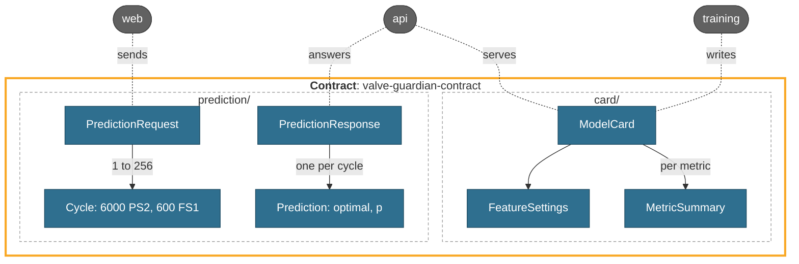

# valve-guardian-contract

The pydantic models every side agrees on: the API serves them, the page
sends them, the training writes them.

A dotted line is a side that imports the model; a solid arrow is a model
that holds another.

No side owns a model: a field changes here, and every side sees it at once.

- [`Cycle`](src/valve_guardian_contract/prediction/cycle.py): one cycle, 6000 pressure
  and 600 flow samples, checked on arrival.
- [`PredictionRequest`, `PredictionResponse`](src/valve_guardian_contract/prediction/request.py):
  up to 256 cycles in, one verdict and one probability per cycle out.
- [`ModelCard`](src/valve_guardian_contract/card/model_card.py): the features,
  the metrics, the dataset hash and the versions of a trained model.

It depends on pydantic only.
