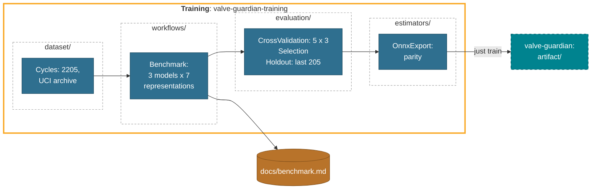

# valve-guardian-training

Everything offline: the only place scikit-learn, XGBoost and MLflow live.

The two evaluations answer different questions: shuffled folds pick the
model, the chronological holdout tells whether it survives the drift of the
last cycles. The card records both. `Trainer` runs the chain, and
`tracking/` keeps the run in `runs/`, or in MLflow when it is set.

- [`dataset/`](src/valve_guardian_training/dataset): downloads and
  fingerprints the UCI dataset, splits it in recording order.
- [`estimators/`](src/valve_guardian_training/estimators): the candidates
  and the ONNX export with its parity check.
- [`evaluation/`](src/valve_guardian_training/evaluation): repeated
  stratified cross-validation, the holdout, the selection.
- [`tracking/`](src/valve_guardian_training/tracking): a local tracker, and
  an MLflow one behind the optional `mlflow` extra.
- [`workflows/`](src/valve_guardian_training/workflows): `benchmark` and
  `train`, the command line `valve-guardian-training`.
