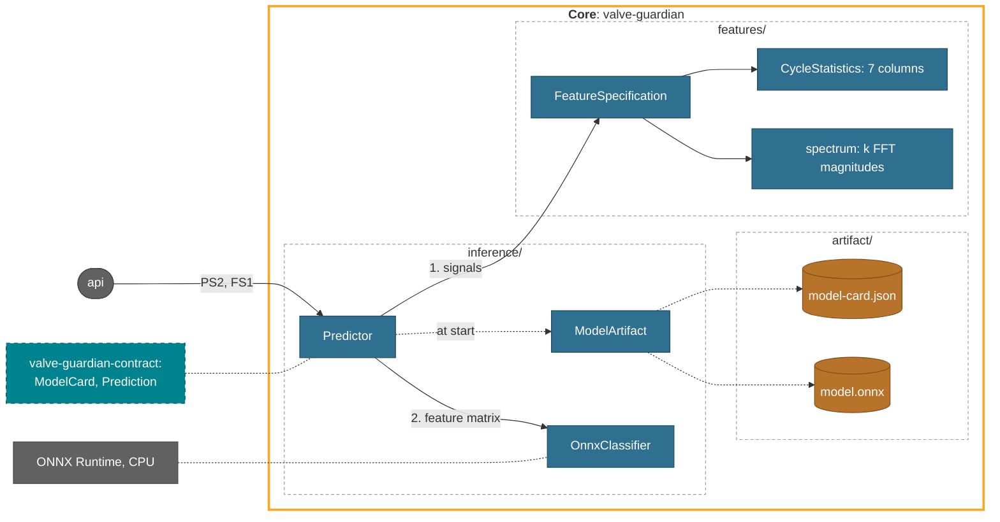

# valve-guardian

The features and the inference: what the API needs, and nothing more.

A solid arrow runs on every request, a dotted one once at start; a dotted
line without a head imports the types of another library.

The card names the features, so the API rebuilds exactly those the model was
trained on. Per signal, the deployed card asks for:

The deployed model uses order 0 and k = 20: 27 columns per signal, 54 in all.

- [`features/`](src/valve_guardian/features): per-cycle statistics, their
  differences and the Fourier magnitudes, in NumPy.
- [`inference/`](src/valve_guardian/inference): loads the model card,
  rebuilds the features it names, runs the ONNX model.
- [`artifact/`](src/valve_guardian/artifact): the deployed `model.onnx` and
  its `model-card.json`, written by `just train`.

It depends on NumPy, ONNX Runtime and the contract.
