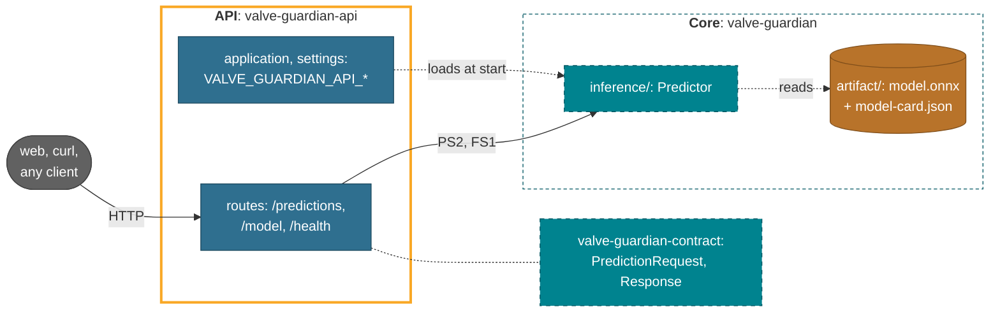

# valve-guardian-api

A FastAPI service over the deployed model; OpenAPI at `/docs`.

A solid arrow runs on every request, a dotted one once at start; a dotted
line without a head imports the types of another library.

No scikit-learn, XGBoost or MLflow here: the model reaches the API as ONNX,
and its card says which features to rebuild.

| Route | Answer |
| --- | --- |
| `POST /predictions` | one verdict and probability per cycle |
| `GET /model` | the model card |
| `GET /health` | `{"status": "ok"}` |

Settings come from `VALVE_GUARDIAN_API_*`: `HOST`, `PORT`,
`MODEL_DIRECTORY`. Run it with `just api`, or build it with
`just image::build api`.
