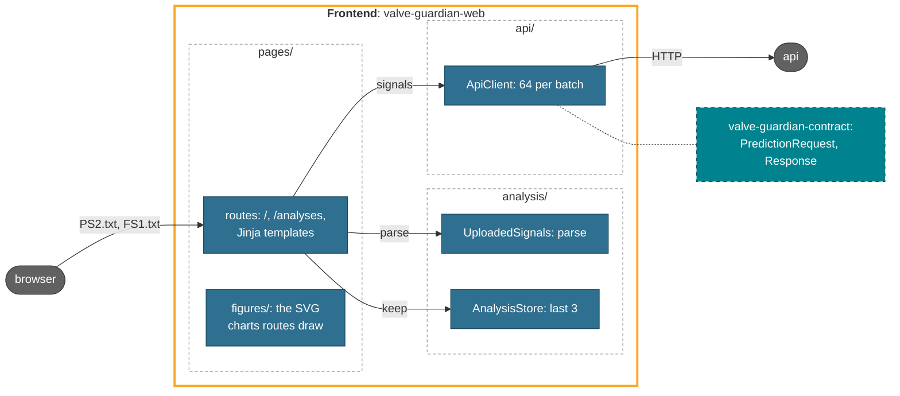

# valve-guardian-web

A server-rendered page that uploads cycles, asks the API, and draws the
verdicts. It is a client of the API like any other: it imports the contract,
never the model.

A solid arrow runs on every upload; a dotted line without a head imports
the types of another library.

The API caps a request at 256 cycles; the client sends 64 at a time and
joins the answers, so a whole recording of 2205 cycles goes through.

The store keeps the last three analyses in memory: a restart, or a fourth
upload, sends the oldest link to a 404 that asks for the files again.

`VALVE_GUARDIAN_WEB_API_URL` says where the API answers; it has no default.
Run it with `just web`, or build it with `just image::build web`.
